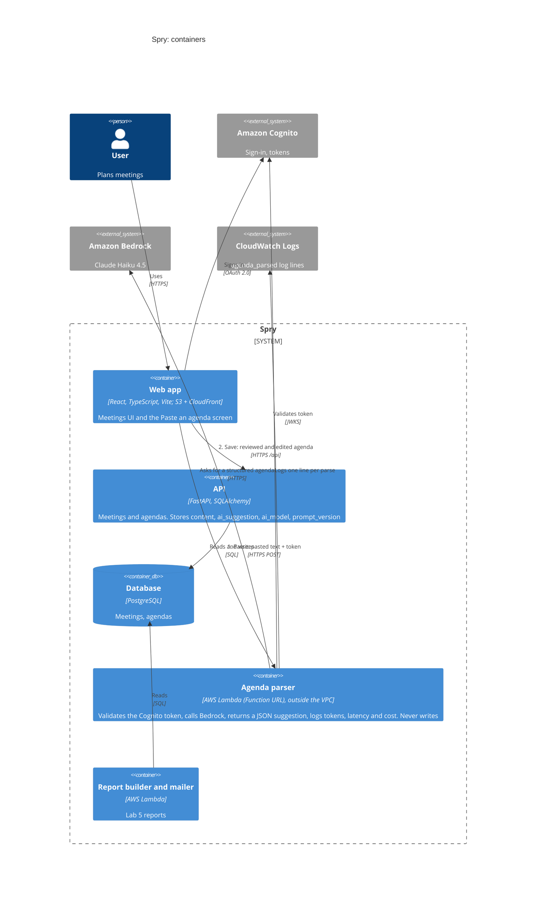

# C4 level 2: container diagram (updated in Lab 6)

New in Lab 6: the parser Lambda (Function URL, Cognito token validation), Amazon Bedrock, and the two flows: **parse** and **save**.

Notes for the diagram:

- Arrow 1 (parse): browser to parser to Bedrock. The parser has no connection to the API or database.
- Arrow 2 (save): browser to API to database, the same path as every other Spry write.
- The parser is outside the VPC, so it needs no NAT and no VPC endpoint.
- If your Lab 1 diagram is in another tool (draw.io, Lucidchart, PowerPoint), add the same three boxes and two numbered arrows there and export it as an image for the submission.
